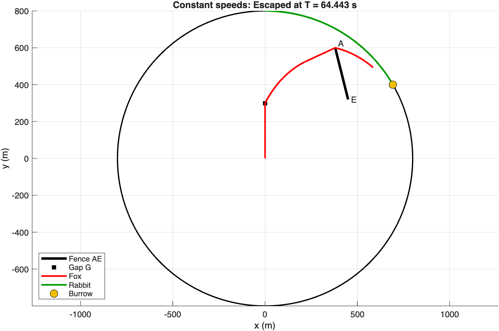

# Fox and rabbit: a pursuit problem with obstacles and fatigue

**Question:** a rabbit runs around the edge of a circular field towards its burrow, and a fox chases it. There is a fence in the way. Does the rabbit make it home?

The model is a system of ODEs solved with `ode45`. It uses event detection to stop the solver at the exact moment of capture or escape, and a geometric line-of-sight test to decide where the fox runs.

| Constant speeds: the rabbit escapes | With fatigue: the fox wins |
|---|---|
|  |  |

## The setup

- **Field:** a circle of radius R = 800 m. The rabbit starts at the top, (0, 800), and runs clockwise along the edge towards its burrow at angle π/3.
- **Fox:** starts at the centre and must first pass through a gap G = (0, 300). It then chases the rabbit, but a fence from A = (380, 600) to E = (450, 320) can block its view.
- **Speeds:** the fox runs at 16 m/s and the rabbit at 13 m/s.

## The model

The state is **y** = [xf, yf, df, θ, dr]: the fox's position, the distance the fox has run, the rabbit's angle, and the distance the rabbit has run.

$$\frac{d\theta}{dt} = \frac{s_r}{R}, \qquad \frac{d\mathbf{r}_f}{dt} = s_f\,\mathbf{u}, \qquad s(d) = s_0\, e^{-\mu d}$$

where **u** is the unit vector towards the fox's current target.

1. **Phase 1:** the fox runs straight to G. An event function stops the solver when the fox arrives.
2. **Phase 2:** at every right-hand-side evaluation, the fox checks whether the segment from itself to the rabbit crosses the fence (a cross-product sign test in [`segments_intersect.m`](segments_intersect.m)). If the fence is in the way, the fox heads for corner A. Otherwise it runs straight at the rabbit.
3. **Termination:** two terminal events stop the solver: **capture** (the fox gets within 0.1 m of the rabbit) and **escape** (θ reaches π/3).

Constant speed is the special case μ = 0, so a single function, [`simulate_chase(mu_f, mu_r)`](simulate_chase.m), covers both scenarios.

## Results

| Scenario | Outcome | Time T | Fox at T | Gap at T | Fox distance |
|---|---|---|---|---|---|
| Constant speeds (μ = 0) | 🐇 **Escaped** | 64.443 s | (585.5, 492.8) | 141.9 m | 1031.1 m |
| Fatigue (μf = 0.0002, μr = 0.0008) | 🦊 **Captured** | 76.743 s | (634.9, 486.8) | 0.1 m | 1098.0 m |

**Interpretation:** at constant speeds, the detour around the fence costs the fox enough time for the rabbit to reach the burrow. Once fatigue is added, the rabbit tires four times faster than the fox, and that endurance gap matters more than the obstacle. The fox catches the rabbit just short of the burrow.

## How it's tested

[`tests/test_pursuit.m`](../tests/test_pursuit.m) checks:
- the intersection test on crossing, parallel and "would meet if extended" segments
- that in the constant-speed case the escape time matches the closed form T = Rπ / (3 sr) = 64.443 s to 10⁻⁶
- that the fatigue case ends in capture at the 0.1 m tolerance

## Changes since the original submission

- The two near-identical scripts are merged into one parameterised `simulate_chase` function, and plotting is split out into `plot_chase`.
- The intersection test is now in its own file, so it can be unit tested. This also fixed a typo in the fatigue version (`P1(2)` where `P1(1)` was meant). It didn't change the reported results.
