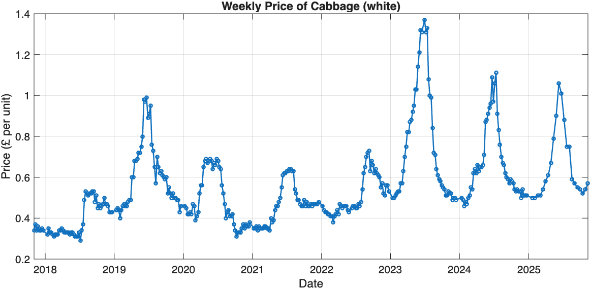
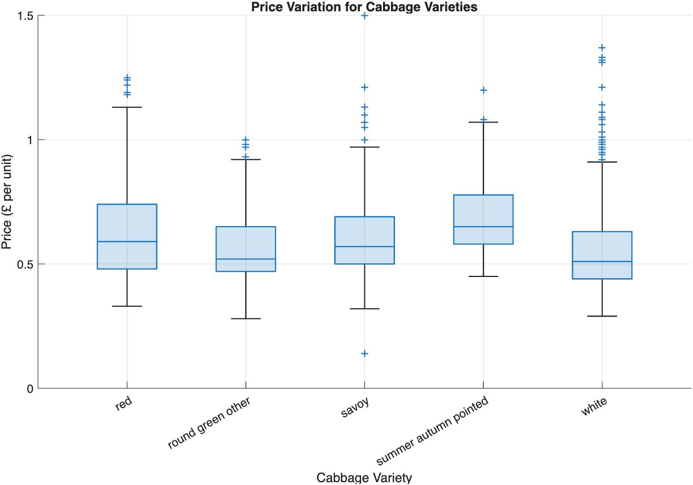
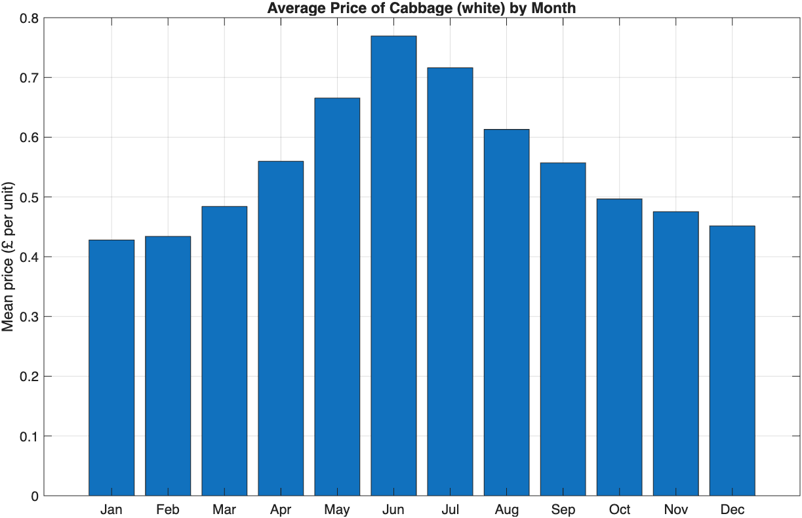
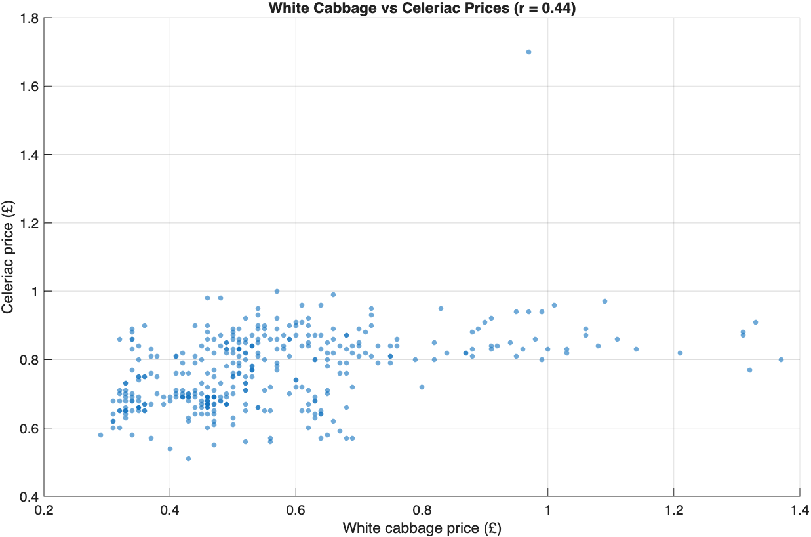

# UK fruit & vegetable prices: what drives the price of cabbage?

An exploratory analysis of **16,764 weekly UK wholesale price records** covering 54 products from November 2017 to November 2025. It uses tables, grouped statistics, distributions, seasonality and correlation, all in MATLAB.



## Questions and findings

### 1. What's in the data?
There are **54 distinct items**, from apples to watercress. Some have several varieties: cabbage has 5 and capsicum has 4. Others, such as celeriac and Brussels sprouts, have just one. Cabbage has enough varieties to compare, so the rest of the analysis focuses on it.

### 2. Are some cabbage varieties systematically more expensive?

| Variety | n | Mean price | Std dev |
|---|---|---|---|
| white | 378 | **£0.557** (cheapest) | £0.196 |
| round green other | 372 | £0.563 | £0.125 |
| savoy | 357 | £0.606 | £0.153 |
| red | 379 | £0.622 | £0.200 |
| summer autumn pointed | 267 | **£0.683** (dearest) | £0.131 |

### 3. How do their price distributions differ?



The interquartile ranges are similar across varieties, but the tails are not. **White** and **savoy** have the most extreme price spikes. **Summer autumn pointed** is the most expensive but also the most stable.

### 4. Is there a seasonal pattern?



Yes, and it repeats every year. White cabbage is cheapest in winter (about £0.43 in January) and peaks in **June**, at about £0.77, nearly double the winter level. This matches the UK's *"hungry gap"*: stored crops run out in late spring before the new harvest arrives.

Two longer-term shifts are also visible in the time series. The off-season baseline rose from about £0.35 in 2018 to about £0.50 by 2024–25. And the summer peaks have been much sharper since 2023, reaching £1.37 in mid-2023.

### 5. Do cabbage and celeriac prices move together?



After the two series are aligned on their 377 common dates with an inner join, the Pearson correlation is **r = 0.44**. That is a moderate positive relationship. Both crops share some broad seasonal and market pressures, but each is mostly driven by its own supply conditions.

## Techniques used
`readtable` · logical indexing on string columns · `groupsummary` (by group and by month of year) · `boxchart` · `datetime` time series · `innerjoin` to align series · `corrcoef`

## Run it
```matlab
>> cd 03-fruit-veg-prices
>> analysis
```
It prints every result above and writes the figures to [`figures/`](figures/). It uses only base MATLAB, with no toolboxes required.

## Data
[`data/fruitandvegprices.csv`](data/fruitandvegprices.csv) contains wholesale fruit and vegetable prices published by the UK Department for Environment, Food & Rural Affairs (Defra) under the [Open Government Licence v3.0](https://www.nationalarchives.gov.uk/doc/open-government-licence/version/3/).
