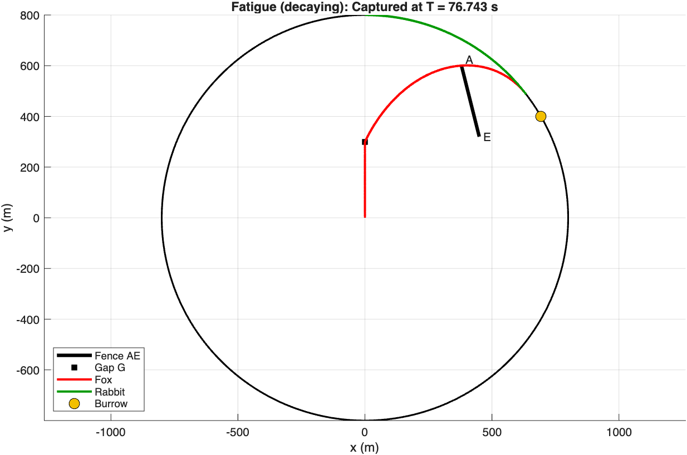

# Problem Solving with MATLAB

[](https://github.com/GITHUB_USER/matlab-problem-solving/actions/workflows/tests.yml)


Three computational projects from my third-year Mathematics degree at the University of Manchester. They cover **exact arithmetic**, **ODE simulation** and **data analysis**. Each one is reproducible from a single script, and the core logic is covered by unit tests that run automatically on every push.

| | Project | What it shows |
|---|---|---|
|  | **[Fox & rabbit pursuit](02-fox-rabbit-pursuit/)**<br>Does the rabbit reach its burrow before the fox, given a fence and fatigue? | Mathematical modelling, `ode45` with event detection, computational geometry, parameter studies |
|  | **[UK fruit & veg prices](03-fruit-veg-prices/)**<br>16,764 Defra price records: varieties, seasonality, correlation | Data cleaning, grouped statistics, time series, visualisation, interpretation |
| <code>159! =&nbsp;2946702…000</code><br><sub>(all 283 digits)</sub> | **[Vedic big-integer multiplication](01-vedic-multiplication/)**<br>Exact products and factorials beyond `double` precision | Algorithm design, the link between multiplication and polynomial convolution, testing against reference values |

## Highlights

- **Fatigue changes who wins.** With constant speeds the rabbit escapes with 141.9 m to spare. When speeds decay with distance run, the fox catches it 76.7 s in. → [details](02-fox-rabbit-pursuit/)
- **The UK cabbage "hungry gap" shows up clearly in the data.** White cabbage averages ~£0.43 in January but ~£0.77 in June, and the summer spikes have grown sharper since 2023. → [details](03-fruit-veg-prices/)
- **Exact to the last digit.** All 283 digits of 159! are computed and checked against an independent reference. MATLAB's `factorial` only gets the first ~15 right. → [details](01-vedic-multiplication/)

## Run it

You need MATLAB R2022a or later; no toolboxes are needed. R2025a+ is recommended so that figures render in the light theme.

```matlab
>> run_all     % runs all three projects, prints results, regenerates every figure
>> run_tests   % runs the unit tests
```

## Repository layout

```
01-vedic-multiplication/   string-based big-integer multiply and factorial
02-fox-rabbit-pursuit/     ODE pursuit model, plotting, figures/
03-fruit-veg-prices/       analysis script, data/, figures/
tests/                     matlab.unittest test suites (run in CI via GitHub Actions)
run_all.m  run_tests.m
```

## About

These started as coursework for a *Problem Solving by Computers* module (2025). For this portfolio I restructured them into reusable functions, added tests and CI, fixed a small bug, and rewrote the write-ups. All results match the original submissions.
